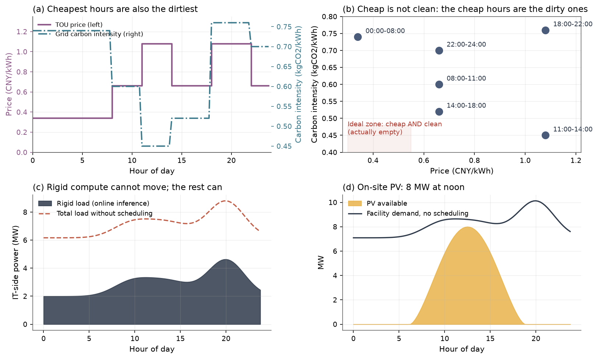
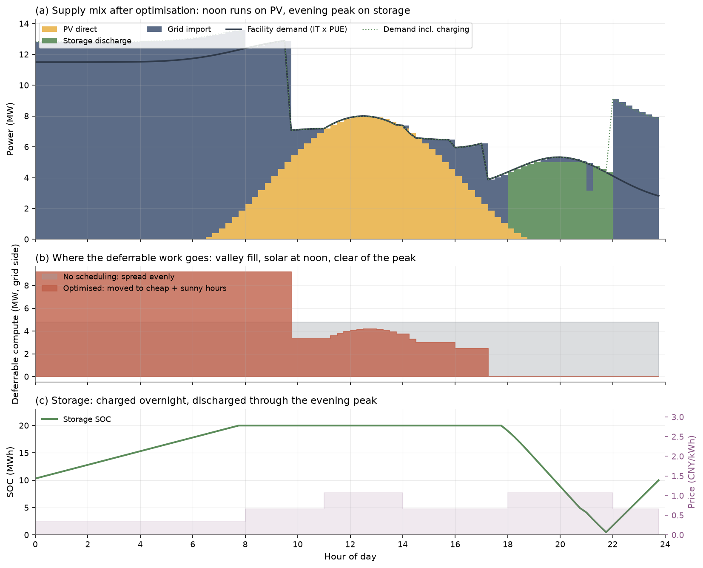
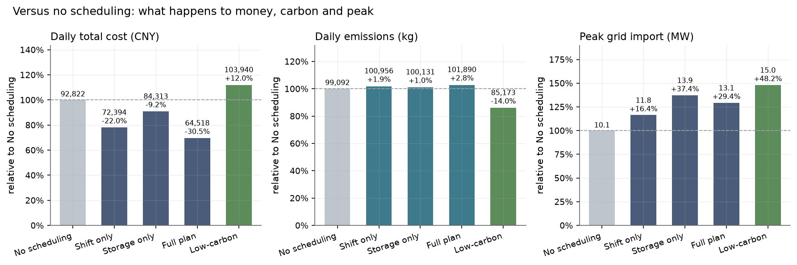
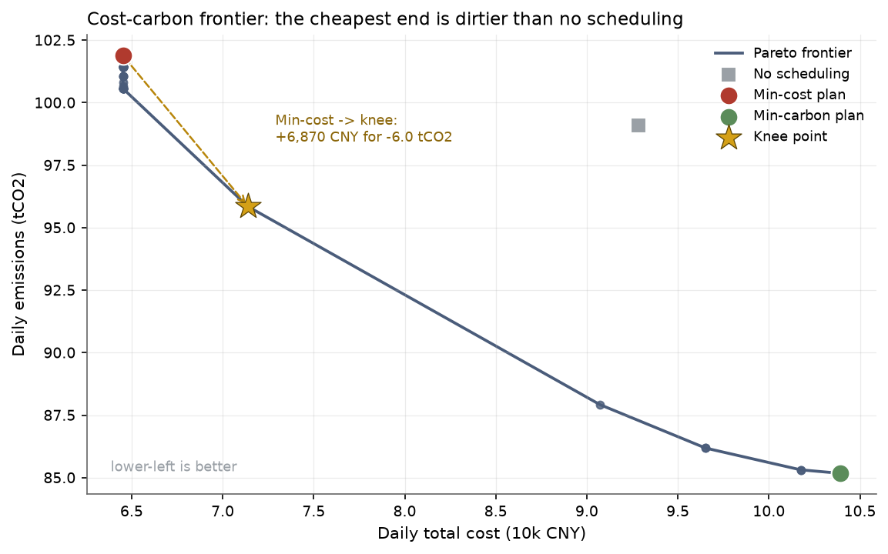
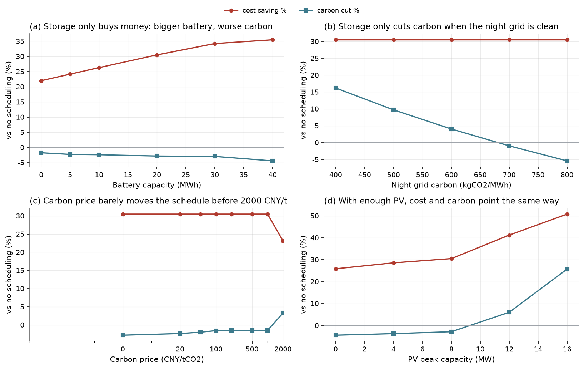
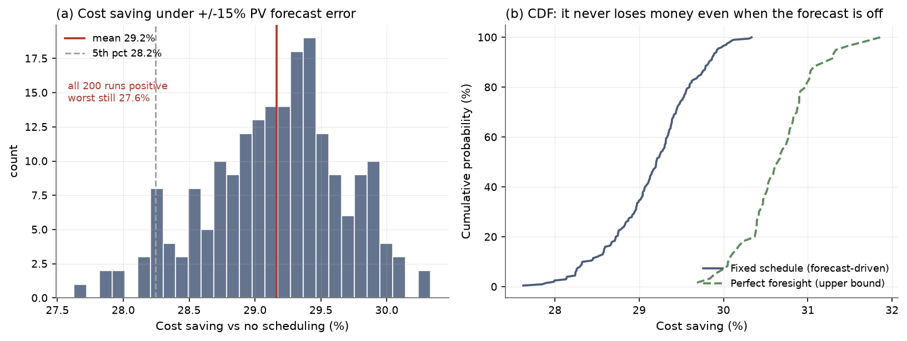

# PeakShift: co-scheduling compute and power in AI data centers

> HackSHSID 2026 · Track 2
> One sentence: **move the work that can wait into the cheap, sunny hours, and use the battery to carry noon's sunlight into the evening peak.**
> One linear program, solved with `scipy`, checked 11 independent ways, reproducible with one command.

---

## 0. What the problem is really asking

The prompt is three sentences, and every one of them describes the same failure to line up:

| The prompt says | Translated into modelling language |
|---|---|
| Green power is cheap but unstable; when it runs short you fall back on the grid, which has a varying price | Supply has two parts: **free, zero-carbon but intermittent** PV, and **priced, carbon-intensive** grid power |
| Compute demand also varies, and tasks have different urgency | Load has two parts: **cannot wait** (online inference) and **can wait** (training, offline batch) |
| The cheapest and cleanest moments are not the moments when demand is highest | This is a **mismatch**, and the only lever is **moving things in time** |

So the problem is a **transport problem along the time axis**: what can be moved, how much, to when, and at what cost.

No data is provided, so step one is not modelling — it is **taking a photograph of reality**.

---

## 1. Step one: take the data center apart

Compute in an AI data center is not one lump. Split it by *can it wait*:

| Workload | Example | Power profile | Movable? | How we treat it |
|---|---|---|---|---|
| Online inference | chat, search, ranking | 2–4.5 MW, follows users, peaks in the evening | ❌ No — latency SLO is hard | a **given curve**, not a decision variable |
| Training | foundation-model pre-training | one job can draw 8 MW for days | ✅ Yes, via checkpoint/restart | **decision variable** |
| Offline inference / batch | data cleaning, embeddings, evals | medium, chunkable | ✅ Yes | **decision variable** (merged above) |
| Storage / network | — | small | — | folded into the rigid load |

> Why training can move: it runs for days and can be paused at checkpoints for about 1–2 % recompute.
> That is exactly why we schedule on **15-minute slots** and add a power-smoothing penalty — jobs are not allowed to flicker on and off.

### Parameters (calibrated from public sources)

| Parameter | Value | Source |
|---|---|---|
| H100 SXM board power | 700 W | [NVIDIA DGX H100 reference design](https://datavault.com.pk/blog-nvidia-h100-h200-kilowatts-per-rack/) |
| 8-GPU node | 10.2 kW | same (DGX H100 under load) |
| Rack density | 35–40 kW (4 nodes/rack) | same |
| This instance's IT peak | 12 MW ≈ **300 racks ≈ 10k H100s** | derived from the two rows above |
| PUE | 1.15 | liquid-cooled AI halls, 1.1–1.2 |
| Industrial TOU tariff | 0.34 / 0.66 / 1.08 CNY·kWh⁻¹ (**3.2× peak-to-valley**) | [peak-valley spread >0.6 CNY/kWh in many provinces](https://desn.com.cn/news/show-1720470.html) |
| Grid carbon intensity | 450–760 kgCO₂/MWh (daily mean 0.58 kg/kWh) | [MEE: 2024 national average electricity carbon footprint 0.5777 kgCO₂e/kWh](https://www.mee.gov.cn/xxgk2018/xxgk/xxgk01/202510/t20251024_1130734.html) |
| Storage | 20 MWh / 5 MW, 90 % round-trip | LFP, matching sponsor Hithium's business |
| Storage degradation | 50 CNY/MWh throughput | derived from 6000 cycles at 0.6 CNY/Wh system cost |
| PV | 8 MW peak, 56 MWh/day | rooftop + direct line |

The daily ledger: 172 MWh of IT energy (72 rigid + 100 deferrable), about 199 MWh on the grid side, 56 MWh of PV.

**One fact in the data drives everything** (figure 1b): **the cheapest hours are exactly the dirtiest.**
00–08 pays 0.34 CNY at 740 kg/MWh; 11–14 emits only 450 kg/MWh but costs 1.08 CNY.
The "cheap *and* clean" cell is empty.



---

## 2. The model: a linear program you can explain

### Decisions (one set per 15-minute slot, 96 slots a day)

| Symbol | Meaning | Unit |
|---|---|---|
| $x_t$ | deferrable compute power | MW |
| $g_t$ | grid import | MW |
| $c_t,\ d_t$ | battery charge / discharge power | MW |
| $s_t$ | PV actually used | MW |
| $E_t$ | state of charge at end of slot | MWh |

### Constraints (each one is a sentence in plain language)

$$
\begin{aligned}
&\text{power balance} && g_t+s_t+d_t=c_t+\mathrm{PUE}\cdot(L^{rig}_t+x_t) && \text{supply} = \text{demand} + \text{charging}\\
&\text{work total}    && \sum_t x_t\Delta t=W && \text{all 100 MWh must be delivered}\\
&\text{deadline}      && x_t=0,\ t\ge t_{dl} && \text{done before 20:00}\\
&\text{storage}       && E_t=E_{t-1}+\eta c_t\Delta t-d_t\Delta t/\eta && \text{round-trip losses}\\
&\text{capacity}      && 0\le E_t\le E_{max},\ 0\le c_t,d_t\le B_p && \text{no overcharge, no overload}\\
&\text{transformer}   && g_t\le G_{max} && \text{15 MW limit}\\
&\text{PV}            && 0\le s_t\le \bar s_t && \text{cannot generate what the sky does not give}
\end{aligned}
$$

### Objective

$$
\min\ \underbrace{\sum_t p_t g_t\Delta t}_{\text{electricity bill}}+\underbrace{\lambda\sum_t e_t g_t\Delta t}_{\text{carbon cost}}+\underbrace{d_{deg}\sum_t(c_t+d_t)\Delta t}_{\text{battery wear}}+\underbrace{\varepsilon\sum_t u_t\Delta t}_{\text{smoothing}}
$$

$\lambda$ is the carbon price (CNY/kg). At $\lambda=0$ we optimise money only; at large $\lambda$, carbon only; in between we trace the Pareto frontier.

### Why a linear program

1. **It can be proved optimal** — the solver returns a dual bound, so we do not have to say "it seems to run well".
2. **It can be explained** — every constraint has a physical meaning, and the dual of the price constraint is the shadow price of a MWh.
3. **It extends cleanly** — a demand charge or a carbon cap is one extra row, not a new model.
4. **It is fast** — 768 variables in about 20 ms, fast enough to sit inside a live controller.

---

## 3. Results



The schedule (figure 2):

- **00–08** — all 8 MW of deferrable work goes into the valley, while the battery charges steadily at 1.3 MW (steadily, not at full blast, to avoid raising the peak).
- **08–11** — deferrable work halves; PV starts to take over.
- **11–14** — **grid import drops to zero**: in the dirtiest hours the facility runs entirely on its own PV.
- **17–18** — deferrable work stops, clearing the whole evening peak.
- **18–22** — storage covers the rigid load; the grid barely participates.

### Compared with no scheduling

| Plan | Daily cost | Daily emissions | Peak import |
|---|---|---|---|
| No scheduling (work spread evenly, battery idle) | 92,822 CNY | 99,092 kg | 10.1 MW |
| Shift only | 72,394 CNY (**−22.0 %**) | 100,956 kg (+1.9 %) | 11.8 MW |
| Storage only | 84,313 CNY (−9.2 %) | 100,131 kg (+1.0 %) | 13.9 MW |
| **Full plan** | **64,518 CNY (−30.5 %)** | 101,890 kg (**+2.8 %**) | 13.1 MW |
| Low-carbon ($\lambda$ maxed) | 103,940 CNY (+12.0 %) | 85,173 kg (−14.0 %) | 15.0 MW |



**30.5 % off the bill, 435 CNY per purchased MWh instead of 654 — and carbon emissions go *up* by 2.8 %.**
That is not a bug. It is the most interesting thing in the problem.

---

## 4. Answering the five questions in the prompt

### Q1. How do you define "good", and what do you measure?

Not with one number. Four:

1. **Money** — daily total cost = electricity + battery wear (CNY/day)
2. **Carbon** — daily emissions (kgCO₂/day)
3. **Grid friendliness** — peak grid import (MW), which sets transformer capacity and demand charges
4. **Service** — every deferred job delivered before its deadline (a hard constraint here, so it always holds)

Plus a comparable efficiency metric: **cost and carbon per purchased MWh**.

### Q2. Better than "no scheduling", and by how much?

- **Money: −30.5 %**, 28,304 CNY a day, about **10.3 million CNY a year**.
- **Carbon: +2.8 %** — i.e. worse.
- **Peak: 10.1 → 13.1 MW** — also worse.

We are not going to hide the last two. Honestly: **a schedule that only optimises price saves money and emits more.**
The Pareto frontier offers the fix: walking from the min-cost point to the knee costs **+6,870 CNY (+10.6 %) and removes 6.0 tCO₂ (−5.9 %)**, and every step on that curve already beats "no scheduling" on both axes.



### Q3. Why believe the results are close to optimal?

Four independent pieces of evidence, all reproducible with `python src/verify.py`:

| Evidence | Result |
|---|---|
| Dual bound equals primal objective | HiGHS reports `optimal`, duality gap 0 |
| **Different algorithm**, same problem (dual simplex vs interior point) | objectives differ by **3.4×10⁻¹⁶** |
| **Brute force**: 4 slots × 21 power levels = 194,481 schedules | LP = brute force = **21,649.62 CNY**, to the cent |
| **Independent greedy** (fill by price order) | 80,736 CNY ≥ LP 64,518 CNY |
| 8 feasibility re-checks (balance, SOC, deadline, limits…) | residuals ≤ 10⁻¹⁴ |

> The third one matters most. We shrink the problem to four slots, discretise power to 0.2 MW steps and
> **enumerate every feasible schedule**. The LP matches the enumeration exactly — so the LP is not
> inventing an optimum that cannot be realised.

### Q4. Does it still hold when conditions change? When does it fail?



**(a) ±15 % PV forecast error, 200 Monte Carlo draws** (figure 6): mean saving 29.2 %, 5th percentile 28.2 %, **worst 27.6 %, all 200 runs positive**.
Perfect foresight would give 30.7 % — forecast error costs only 1.5 percentage points, because the battery absorbs the deviation.



**(b) Where it breaks** (important):

| Condition | What happens |
|---|---|
| Deadline pulled to 12:00 | **Infeasible**: 100 MWh does not fit in a 96 MWh window |
| Deadline pulled to 14:00 | Still feasible, but saving drops to 29.6 % and carbon change worsens to −3.5 % |
| Shandong-style grid with a midday valley | Better: saves **39.4 %** and cuts carbon **2.4 %** |
| Wind-rich grid (clean nights) | Cuts carbon **14.2 %**; the plan flips from "emits more" to "emits less" |
| Night carbon intensity above 680 kg/MWh | Carbon reduction turns negative (this instance sits at 740, inside the negative region) |

### Q5. Are the assumptions reasonable? What if they are wrong?

| Assumption | Strength | If it fails |
|---|---|---|
| Training jobs can be paused (checkpointed) on a 15-min granularity | strong | If jobs are truly uninterruptible, deferrable energy goes to zero and the plan degenerates to "storage only": saving falls from 30.5 % to 9.2 % |
| TOU tariffs are published in advance | strong | If pricing were real-time, we would roll the horizon; the model itself is unchanged |
| PV surplus is curtailed, no export | medium | If export were allowed, curtailment becomes revenue and scheduling gets more aggressive |
| Grid carbon is low at noon, high at night | **weak** | **This is the fragile one.** Swap to the wind-rich scenario C and the storage conclusion flips (see Q4) |
| Storage cost is linear, no capacity fade | medium | Slightly overstates arbitrage value; direction unchanged |

---

## 5. Three counter-intuitive findings

### ① Cheapest ≠ cleanest, and the gap is an order of magnitude

With a 3.2× peak-to-valley ratio, the price signal pushes compute into the **highest-carbon** hours.
The cost-only plan saves 30.5 % and pays for it with 2.8 % more carbon. **This is the trap in most "green scheduling" pitches.**

### ② Storage buys money, not carbon

The intuition is that a battery carries noon's sunlight into the evening. In this instance:

- noon PV is **already fully absorbed by compute**, so there is no surplus to store;
- the battery actually charges on **deep-night coal** (740 kg/MWh) and discharges into the evening peak (760 kg/MWh);
- with 90 % round-trip efficiency, delivering 1 MWh requires charging 1.11 MWh.

Do the arithmetic: 1 MWh discharged avoids 760 kg, but charging it emits 822 kg — **a net increase of 62 kg**.
So the bigger the battery, the worse the carbon (figure 5a: −1.8 % at 0 MWh, −4.4 % at 40 MWh).

**The climate value of a battery depends on what it charges from, not on how big it is.**

### ③ Carbon pricing does almost nothing; PV does a lot

Carbon price from 0 to 1000 CNY/t leaves the schedule **unchanged** (figure 5c). It takes **2000 CNY/t** — more than 20× the current national ETS price — before anything moves.

The marginal abatement cost on the frontier is **2,358 CNY/tCO₂**, far above any carbon price.
Raising PV from 8 MW to 16 MW, on the other hand, is immediately a win-win: **50.8 % cheaper and 25.7 % less carbon**.

**To make an AI data center green, build solar rather than buy allowances.**

---

## 6. Limitations and next steps

1. **Single-day horizon.** Real demand charges bill the **monthly** peak, which a one-day model cannot set. We ran a daily-peak proxy (`results/tables/demand_charge.csv`): at 600 CNY/MW/day the optimiser voluntarily caps the peak at 12.8 MW instead of 13.1 MW for about +12 % on the bill. A proper treatment needs a 30-day rolling model.
2. **Determinism.** We Monte-Carlo the PV forecast but do not build a two-stage stochastic or robust formulation.
3. **Job granularity.** Deferrable work is one pool of energy; indivisible jobs would need integers (MILP).
4. **No spatial flexibility.** Sending work to another data center in another price zone would help more — "load migration" is what hyperscalers actually do.

---

## Appendix: layout

```
dc-scheduler/
├── src/            profiles.py inputs / optimizer.py LP / verify.py checks / plots.py figures / run_all.py entry point
├── results/        figures/ 6 charts + cover / tables/ 7 CSVs
├── docs/           report.md + model.md + framework.md (English) / zh/ (original Chinese notes)
└── logs/           run_log.txt (full run log = the test evidence)
```

Reproduce: `pip install -r requirements.txt && python src/run_all.py` (about 6 s).
